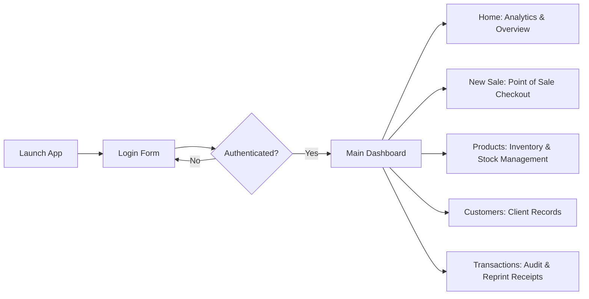

<div align="center">

# 🛒 SwiftPOS - Point of Sale & Inventory Management System

[](https://www.oracle.com/java/)
[](https://maven.apache.org/)
[](https://www.mysql.com/)
[](https://docs.oracle.com/javase/tutorial/uiswing/)
[](LICENSE)

<p align="center">
  <b>A modern, high-performance desktop Point of Sale (POS) and Retail Management System developed in Java Swing and backed by MySQL.</b>
  <br />
  Designed for small to medium retail businesses, supermarkets, boutiques, and pharmacies.
</p>

[Explore Features](#-key-features) •
[Database Setup](#-database-setup) •
[Quickstart](#-installation--quickstart) •
[Project Structure](#-project-structure) •
[Author](#-author)

---

</div>

## 📌 Overview

**SwiftPOS** is a robust, modular desktop application designed to streamline daily retail store operations. Built using Java Swing with clean UI principles and backed by a relational MySQL database via JDBC, SwiftPOS offers real-time inventory tracking, cashier checkout workflows, automated receipt generation, transaction auditing, and business metrics tracking in one unified interface.

---

## ✨ Key Features

### 🔐 1. Authentication & Access Control
- Secure login portal for authorized cashiers and administrators.
- Credential validation with SQL injection protection using `PreparedStatement`.
- Automatic session routing to the main dashboard.

### 📊 2. Real-Time Business Dashboard (`HomePanel`)
- **Today's Revenue**: Live aggregation of day's gross sales.
- **Order Count**: Daily count of transactions handled.
- **Inventory Metrics**: Total registered products and real-time count of low-stock items (< 10 units).
- **Recent Transactions Feed**: At-a-glance list of the latest 10 customer orders with quick details.

### ⚡ 3. Fast Checkout & Billing (`NewSalePanel`)
- **Barcode & Item Lookup**: Fast search by item name or barcode scanner integration.
- **Dynamic Cart Management**: Add items, update quantities, calculate line-item totals, and remove items with instant table updates.
- **Automated Inventory Reduction**: Stock quantities decrement automatically upon checkout completion.
- **Multiple Payment Modes**: Support for **Cash** and **Card** payments.
- **Smart Change Calculator**: Auto-calculates net total, applied discounts, paid amount, and customer change balance.
- **Instant Receipt Generation**: Built-in formatted receipt generator with thermal-style bill printing.

### 📦 4. Inventory & Product Management (`ProductsPanel`)
- Comprehensive CRUD operations (Create, Read, Update, Delete) for items.
- **Auto-generated Product Barcodes** (e.g., `F1001`, `F1002`).
- Categorization (Dairy, Groceries, Beverages, Bakery, Snacks, etc.).
- Real-time stock levels, retail pricing, and search by barcode or name.

### 👥 5. Customer Relationship Management (`CustomersPanel`)
- Maintain detailed records: Name, Phone Number, Email, and Billing Address.
- Quick customer lookup by phone number or name during checkout.
- Full customer record editing and auditing capabilities.

### 🧾 6. Sales History & Transaction Audit (`TransactionsPanel`)
- Complete repository of past sales identified by unique Invoice IDs (`INV-XXXX`).
- Timestamped transaction history with subtotal, discounts, net totals, payment methods, and balances.
- **Drill-down Item Inspection**: Select any transaction to view line-by-line items purchased, quantities, and prices.
- **Reprint Bills & Invoices**: Re-generate receipts on demand for past orders.
- Record management with confirmation safeguards for bill deletion.

---

## 🛠️ Tech Stack & Architecture

| Component | Technology | Description |
|---|---|---|
| **Language** | Java (JDK 17+) | Core object-oriented business logic |
| **User Interface** | Java Swing + Nimbus L&F | Desktop GUI components and forms |
| **Database** | MySQL 8.0+ | Relational data persistence |
| **Driver / ORM** | MySQL Connector/J 8.0.33 | JDBC connection pooling & queries |
| **Build Tool** | Apache Maven | Dependency management & project lifecycle |
| **IDE Support** | NetBeans / IntelliJ / VS Code | Form designer & code scaffolding |

---

## 📂 Project Structure

```text
SwiftPOS-System/
├── src/
│   ├── main/
│   │   ├── java/com/mycompany/pos_system/
│   │   │   ├── POS_System.java          # Application launcher & main entry point
│   │   │   ├── DBConnect.java           # Centralized MySQL JDBC connection manager
│   │   │   ├── LoginForm.java           # User authentication interface & form
│   │   │   ├── LoginForm.form           # Swing UI form metadata
│   │   │   ├── MainDashboard.java       # Navigation shell & container window
│   │   │   ├── MainDashboard.form       # Swing UI form metadata
│   │   │   ├── HomePanel.java           # Dashboard metrics & overview stats
│   │   │   ├── HomePanel.form           # Swing UI form metadata
│   │   │   ├── NewSalePanel.java        # Point of sale checkout, cart & billing
│   │   │   ├── NewSalePanel.form        # Swing UI form metadata
│   │   │   ├── ProductsPanel.java       # Product inventory management
│   │   │   ├── ProductsPanel.form       # Swing UI form metadata
│   │   │   ├── CustomersPanel.java      # Customer records management
│   │   │   ├── CustomersPanel.form      # Swing UI form metadata
│   │   │   ├── TransactionsPanel.java   # Sales audit & receipt re-printing
│   │   │   └── TransactionsPanel.form   # Swing UI form metadata
│   └── test/
├── database.sql                         # Complete database schema & seed data
├── pom.xml                              # Maven configuration & dependencies
├── nbactions.xml                        # NetBeans actions configuration
├── .gitignore                           # Git ignore rules for build & IDE files
└── README.md                            # Project documentation
```

---

## 🗄️ Database Setup

The project includes a ready-to-run SQL schema file: [`database.sql`](./database.sql).

### 1. Import Schema & Sample Data
You can import the database using your MySQL command line or MySQL Workbench:

```bash
# Using MySQL Command Line Client
mysql -u root -p < database.sql
```

Alternatively, open **phpMyAdmin** or **MySQL Workbench**, create a new database named `pos_system`, and execute the queries from [`database.sql`](./database.sql).

### 2. Database Tables Overview
- **`users`**: User accounts and login credentials.
- **`products`**: Item inventory, barcodes, category, prices, and quantities.
- **`customers`**: Customer directory and contact details.
- **`sales`**: Order headers (subtotal, discount, net total, payment method, date).
- **`sale_items`**: Individual line items associated with each sale invoice.

### 3. Default Credentials
| Role | Username | Password |
|---|---|---|
| **Administrator** | `admin` | `admin` |
| **Cashier** | `cashier` | `1234` |

---

## 🚀 Installation & Quickstart

### Prerequisites
Ensure the following dependencies are installed on your machine:
- **Java Development Kit (JDK)**: Version 17 or higher (`java -version`)
- **Apache Maven**: Version 3.8 or higher (`mvn -version`)
- **MySQL Server**: Running on `localhost:3306`

### Step 1: Clone the Repository
```bash
git clone https://github.com/umindudinal/SwiftPOS-System.git
cd SwiftPOS-System
```

### Step 2: Configure Database Credentials
Open `src/main/java/com/mycompany/pos_system/DBConnect.java` and adjust your MySQL username and password:
```java
conn = DriverManager.getConnection("jdbc:mysql://localhost:3306/pos_system", "YOUR_USERNAME", "YOUR_PASSWORD");
```

### Step 3: Build & Run the Application

#### Option A: Using Maven (Terminal / CLI)
```bash
# Clean and compile
mvn clean compile

# Execute the application
mvn exec:java
```

#### Option B: Using NetBeans IDE
1. Open **Apache NetBeans**.
2. Select **File > Open Project...** and choose the `SwiftPOS-System` directory.
3. Right-click the project and choose **Clean and Build**.
4. Click the green **Run** button or press <kbd>F6</kbd>.

#### Option C: Using IntelliJ IDEA or VS Code
1. Open the project folder in IntelliJ IDEA or VS Code (with *Extension Pack for Java* installed).
2. Allow Maven to import dependencies automatically.
3. Navigate to `src/main/java/com/mycompany/pos_system/POS_System.java` and click **Run**.

---

## 🖥️ User Workflow



---

## 🔮 Roadmap & Future Enhancements

- [ ] ESC/POS Thermal Printer direct USB/Network integration.
- [ ] Export reports (Daily, Monthly, Annual) to PDF & Excel using JasperReports / Apache POI.
- [ ] Role-based Access Control (RBAC) permissions matrix (Admin vs. Cashier view).
- [ ] Barcode label printing generator.
- [ ] Multi-store cloud database synchronization.

---

## 🤝 Contributing

Contributions, issues, and feature requests are welcome!
Feel free to check the [issues page](https://github.com/umindudinal/SwiftPOS-System/issues).

1. Fork the Project (`git checkout -b feature/AmazingFeature`)
2. Commit your Changes (`git commit -m 'Add some AmazingFeature'`)
3. Push to the Branch (`git push origin feature/AmazingFeature`)
4. Open a Pull Request

---

## 📄 License

This project is open-source and licensed under the [MIT License](LICENSE).

---

## 👤 Author

**Umindu Dinal**
- GitHub: [@umindudinal](https://github.com/umindudinal)
- Project Repository: [SwiftPOS-System](https://github.com/umindudinal/SwiftPOS-System)

---

<div align="center">
  <sub>Built with ❤️ by Umindu Dinal using Java & MySQL</sub>
</div>
